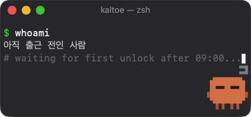
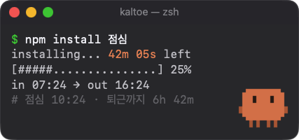
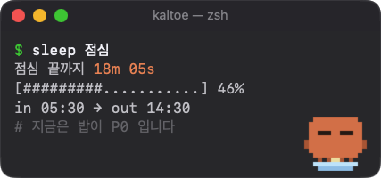
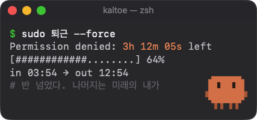
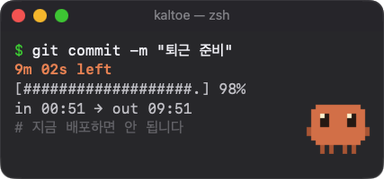
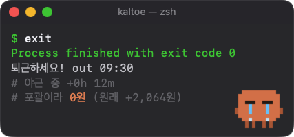
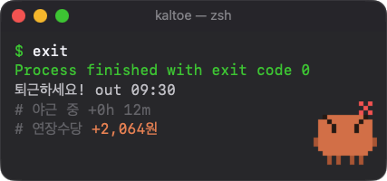
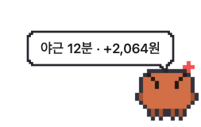

<p align="center"></p>

# 칼퇴 (Kaltoe)

퇴근까지 남은 시간을 화면 위에 띄워 주는 작은 위젯입니다. 맥과 윈도우에서 같은 방식으로 동작합니다.

출근 시각이 매일 달라도 됩니다. 컴퓨터를 처음 켠 시각을 출근으로 보고 퇴근 시각을 알아서 계산합니다.
출퇴근 시각이 정해져 있다면 고정 모드로, 점심시간까지 남은 시간도 함께 볼 수 있습니다.

```
● ● ●            kaltoe — zsh
$ sudo 퇴근 --force
Permission denied: 3h 12m 08s left
[############........] 64%
in 09:16 → out 18:16
# 반 넘었다. 나머지는 미래의 내가▋
```

## 다운로드

| 운영체제 | 파일 |
|---|---|
| macOS 14 이상 (Apple Silicon) | [Kaltoe-mac.zip](https://github.com/alice9547/kaltoe/releases/latest/download/Kaltoe-mac.zip) |
| Windows 10 / 11 (64비트) | [Kaltoe-windows.zip](https://github.com/alice9547/kaltoe/releases/latest/download/Kaltoe-windows.zip) |

개인이 만든 앱이라 서명이 없습니다. 처음 열 때 운영체제가 경고를 띄우는데, 아래 방법으로 한 번만 넘기면 됩니다.

### 맥에서 처음 열기

1. 압축을 풀고 `Kaltoe.app`을 `응용 프로그램` 폴더로 옮깁니다.
2. 더블클릭하면 "확인되지 않은 개발자" 경고가 뜹니다. 창을 닫습니다.
3. `시스템 설정 → 개인정보 보호 및 보안`으로 가서 아래쪽의 **"그래도 열기"**를 누릅니다.
4. 알림 권한을 물으면 허용합니다(퇴근·점심 알림에 필요).

터미널이 편하면 이 한 줄로도 됩니다.

```sh
xattr -dr com.apple.quarantine /Applications/Kaltoe.app && open /Applications/Kaltoe.app
```

### 윈도우에서 처음 열기

1. 압축을 풀고 `Kaltoe.exe`를 원하는 폴더에 둡니다(예: `문서\Kaltoe`). 자동 실행이 이 위치를 기억하므로 나중에 옮기지 않는 편이 좋습니다.
2. 더블클릭하면 "Windows의 PC 보호" 창이 뜹니다. **추가 정보 → 실행**을 누릅니다.
3. 화면 오른쪽 위에 위젯이 뜨고, 작업 표시줄 오른쪽 트레이에 강아지 아이콘이 생깁니다. 아이콘이 안 보이면 `∧`(숨겨진 아이콘)를 눌러 찾은 뒤 작업 표시줄로 끌어다 놓으세요.

### 다른 사람에게 공유하기

받는 사람은 GitHub 계정도, 개발 도구도 필요 없습니다. 아래 주소 하나만 보내면 됩니다.

**https://github.com/alice9547/kaltoe/releases/latest**

1. 위 주소를 열면 맨 아래 **Assets**에 파일 두 개가 있습니다.
2. 맥이면 `Kaltoe-mac.zip`, 윈도우면 `Kaltoe-windows.zip`을 받습니다.
3. 압축을 풀고 위의 "처음 열기" 순서대로 한 번만 경고를 넘기면 됩니다.

파일을 메신저로 직접 보내도 됩니다. 다만 메신저로 받은 파일도 처음 열 때 같은 경고가 뜹니다.
새 버전이 나오면 같은 주소에서 다시 받아 실행하면 됩니다. 설정과 출근 기록은 그대로 남습니다.

**업데이트 (v1.1.1부터)**
- 윈도우: 새 `Kaltoe.exe`를 어느 폴더에서 실행하든, 켜져 있던 옛 버전이 꺼지고 새 버전이 대신 뜹니다. 옛 `Kaltoe.exe`는 자동으로 지워지고, 폴더 이름이 `Kaltoe`로 시작하는 폴더가 비면 그 폴더도 지워집니다. 자동 실행도 새 위치로 바뀝니다. 지워지는 것은 이름이 `Kaltoe.exe`이고 버전이 더 낮은 칼퇴 파일뿐입니다.
- 맥: 새 `Kaltoe.app`을 `응용 프로그램` 폴더로 옮겨 "대치"하고 실행하면 켜져 있던 옛 버전이 꺼집니다. 다른 위치에서 켜져 있던 옛 `Kaltoe.app`은 휴지통으로 옮겨집니다.
- v1.1.0 이하에서 넘어올 때는, 켜져 있지도 않고 자동 실행에도 등록되지 않은 옛 파일까지는 위치를 몰라 남을 수 있습니다. 한 번만 직접 지워 주세요.

## 사용법

### 기본

- 실행해 두기만 하면 됩니다. 처음 실행할 때 **로그인 시 자동 실행**이 켜지므로 다음 날부터는 컴퓨터를 켜면 알아서 뜹니다.
- **위젯 옮기기**: 위젯 아무 곳이나 잡고 끌면 됩니다. 위치는 기억됩니다.
- **위젯 숨기기 / 다시 보이기**: 터미널 모양은 왼쪽 위 빨간 점을 누르면 숨겨집니다. 다시 보려면 메뉴에서 `위젯 보이기`를 고르거나, 앱을 한 번 더 실행하면 화면 오른쪽 위로 돌아옵니다.
- **메뉴 열기**: 위젯을 오른쪽 클릭합니다. 맥은 메뉴바 아이콘, 윈도우는 트레이 아이콘을 오른쪽 클릭해도 같은 메뉴가 나옵니다. (윈도우에서 왼쪽 클릭은 위젯 보이기/숨기기입니다.)
- **강아지**: 누르면 한 번 뜁니다. 출근 전엔 자고, 점심엔 밥을 먹고, 퇴근 10분 전엔 눈이 반짝이고, 퇴근하면 춤춥니다. 야근이 1분을 넘기면 포괄임금제일 땐 울고, 아닐 땐 화를 냅니다.

### 상태별 화면

위젯 모양은 설정에서 **터미널**과 **말풍선** 중에 고를 수 있습니다. 아래 시각은 데모 화면이라 실제와 다릅니다.

| 상태 | 언제 | 터미널 | 말풍선 |
|---|---|---|---|
| **출근 전** | 아직 출근이 안 잡혔을 때 (유동: 기준 시각 이후 첫 잠금 해제 전 / 고정: 출근 시각 전) |  |  |
| **점심 전** | 점심시간을 켰을 때, 점심까지 남은 시간 |  |  |
| **점심시간** | 점심이 끝날 때까지 남은 시간 |  |  |
| **근무 중** | 퇴근까지 남은 시간과 진행률 |  |  |
| **퇴근 임박** | 퇴근 10분 전부터 |  |  |
| **퇴근** | 퇴근 시각이 지났을 때 (포괄임금제 켬, 기본값) |  |  |
| **야근** | 퇴근 후 포괄임금제를 끄면 야근 시간과 연장수당이 보이고 캐릭터가 화남 |  |  |

### 설정

메뉴에서 `설정…`을 누르면 창이 열립니다. 값을 바꾸면 바로 적용됩니다.

| 항목 | 설명 |
|---|---|
| **출근 방식 — 유동** | 지정한 시각(`출근 인정 시작`, 기본 09:00) 이후 컴퓨터를 처음 켠 시각이 출근입니다. 그 전부터 쓰고 있었으면 그 시각으로 칩니다. 퇴근은 출근 + `근무 시간`(기본 9시간, 점심 포함)입니다. |
| **출근 방식 — 고정** | `출근`과 `퇴근` 시각을 직접 정합니다(예: 08:30 ~ 17:30). 컴퓨터를 언제 켰는지는 보지 않습니다. |
| **점심** | 켜면 점심 전에는 "점심까지", 점심 중에는 "점심 끝까지", 그 뒤에는 "퇴근까지" 남은 시간을 보여 줍니다(예: 11:30 ~ 13:00). |
| **알림** | 점심 시작, 퇴근 10분 전, 퇴근 정각을 각각 켜고 끌 수 있습니다. |
| **야근 (연장수당)** | 퇴근 시각이 지나면 야근 시간을 세고, 1분마다 연장수당을 계산해 보여 줍니다. `포괄임금제`가 켜져 있으면(기본) 0원으로 표시하고 원래 받았을 금액을 옆에 보여 줍니다. `연장수당 단가`에 금액을 넣고 `시간당` / `분당`을 고르면 그대로 계산하고, 비워 두면 최저시급(시간당 10,320원, 2026년)으로 계산합니다. 참고용 금액입니다. |
| **위젯 모양** | `터미널`(위 예시) 또는 `말풍선`. 말풍선은 창 없이 강아지만 화면에 앉아 "퇴근 177분 전" 같은 한 줄을 말합니다. 작업 표시줄이나 화면 구석에 올려 두기 좋습니다. |
| **캐릭터** | `말티즈`, `주황이`(픽셀), `사진`(실제 사진 한 장). `사진`을 고르면 `사진 고르기…`로 내 사진을 쓸 수 있습니다(고르지 않으면 내장 강아지 사진). 맥은 사진 속 피사체만 자동으로 오려 내고(못 찾으면 원형으로 자름), 윈도우는 가운데를 원형으로 자릅니다. 이미 배경이 투명한 PNG는 그대로 씁니다. 윈도우에서 배경을 지우고 싶으면 그림판의 `배경 제거`로 먼저 지운 뒤 PNG로 저장해 고르면 됩니다. `기본 사진으로`로 되돌립니다. 위젯, 맥 메뉴바 아이콘, 윈도우 트레이 아이콘이 함께 바뀌고, 맥에서는 Finder의 앱 아이콘도 따라 바뀝니다. |
| **글자 크기** | 8 ~ 32 사이 숫자(px). 위젯 전체가 같이 커지거나 작아집니다. |
| **로그인 시 자동 실행** | 끄면 직접 실행해야 합니다. 유동 모드는 앱이 켜져 있어야 출근을 정확히 잡으므로 켜 두는 것을 권합니다. |

**설정 예시**

- 출근 시각이 매일 다른 경우: 유동, 출근 인정 시작 `09:00`, 근무 시간 `9시간`
- 8:30 출근, 11:30 ~ 1:00 점심, 5:30 퇴근: 고정 `08:30` ~ `17:30`, 점심 켜고 `11:30` ~ `13:00`

### 메뉴 항목

- `출근 09:16` / `퇴근 18:16` / `점심 11:30–13:00`: 오늘 기준 시각(보기 전용)
- `연장수당 +2,064원`: 야근 중일 때만 보입니다.
- `위젯 숨기기` / `위젯 보이기`
- `설정…`
- `오늘 출근 다시 감지`: 유동 모드에서 오늘 출근 시각이 잘못 잡혔을 때 다시 찾습니다.
- `로그인 시 자동 실행`
- `칼퇴 종료`

## 자주 묻는 것

**출근 시각이 실제와 다르게 잡혔어요.**
유동 모드는 "지정 시각 이후 처음 잠금을 푼 시각"을 봅니다. 메뉴의 `오늘 출근 다시 감지`를 눌러 보세요. 계속 안 맞으면 `출근 인정 시작` 시각을 조정하거나 고정 모드를 쓰세요.

**앱을 늦게 켰는데도 출근 시각이 맞게 나와요.**
앱이 꺼져 있던 시간은 운영체제의 깨우기·로그온 기록에서 찾아 채웁니다.

**맥 메뉴바에 아이콘이 안 보여요.**
메뉴바 아이콘이 많으면 노치 뒤로 숨을 수 있습니다. 다른 아이콘을 `⌘`를 누른 채 끌어 정리하면 나타납니다.

**삭제하려면?**
메뉴에서 `로그인 시 자동 실행`을 끄고 `칼퇴 종료`를 누른 뒤, 맥은 `Kaltoe.app`을, 윈도우는 `Kaltoe.exe`를 지우면 됩니다. 윈도우의 설정 파일은 `%APPDATA%\Kaltoe`에 있습니다.

**기록은 어디에 저장되나요?**
출근 기록과 설정은 내 컴퓨터에만 저장되고 어디로도 전송되지 않습니다.

## 직접 빌드

```sh
git clone https://github.com/alice9547/kaltoe.git
cd kaltoe

# 맥 (Xcode 또는 Swift 툴체인 필요)
mac/Scripts/build-app.sh --install    # /Applications/Kaltoe.app 으로 설치 후 실행
(cd mac && swift test)

# 윈도우 (.NET SDK 11 필요) — 자세한 내용은 windows/README.md
dotnet test windows/Kaltoe.sln
dotnet publish windows/Kaltoe.App -c Release -r win-x64 --self-contained true -p:PublishSingleFile=true -p:IncludeAllContentForSelfExtract=true -p:EnableCompressionInSingleFile=true -o publish
```

화면만 빨리 보고 싶으면 데모 모드를 쓰세요. 가짜 데이터가 흐릅니다.

```sh
(cd mac && swift run Kaltoe --demo working --style bubble)     # waiting | beforelunch | lunch | working | almost | done
Kaltoe.exe --demo lunch --font-size 16
```

## 구조

| 경로 | 내용 |
|---|---|
| `docs/spec.md` | 맥·윈도우 공통 명세(설정, 단계 판정, 문구, 마스코트 형식) |
| `mac/` | 맥 앱 (Swift, SwiftUI + AppKit) |
| `windows/` | 윈도우 앱 (C#, WPF) |
| `shared/mascot.json` | 마스코트 픽셀 데이터 원본. `shared/gen-mascot.py`가 양쪽 소스와 아이콘을 생성 |
| `shared/source/maltese-photo.jpeg` | 실사 캐릭터의 원본 사진. `swift shared/make-photo-cutout.swift`가 배경을 지워 `shared/photo-maltese.png`를 만들고, `python3 shared/gen-photo.py`가 양쪽 이미지·아이콘을 생성 |
| `.github/workflows/build.yml` | 두 플랫폼 빌드·테스트, `v*` 태그를 올리면 릴리스 생성 |
